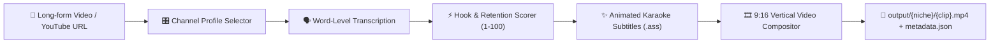

# 🎬 AutoClip — Multi-Channel AI YouTube Shorts Studio

An automated AI-powered video clipping and vertical shorts studio built for creator economies. It transforms long-form videos (podcasts, F1 interviews, tech talks, gaming streams) into viral 9:16 vertical **YouTube Shorts**, **Instagram Reels**, and **TikToks** with animated karaoke subtitles and channel niche separation.

---

## 🌟 Why AutoClip?

The #1 mistake creators make when repurposing content is mixing different audiences on one channel. AutoClip solves this with **Dedicated Channel Profiles**:

| Channel Profile | Target Niche | Handle | Caption Style | AI Focus |
| :--- | :--- | :--- | :--- | :--- |
| 🏎️ **F1 Apex Moments** | Formula 1 & Racing | `@F1ApexMoments` | Speed Yellow + Racing Red | Radio drama, telemetry disputes, stewarding controversy, overtakes |
| 💻 **Silicon & Code Lab** | Tech & Apple Silicon | `@SiliconCodeLab` | Cyber Cyan + Crisp White | Hardware benchmarks, architectural breakthroughs, coding insights |
| 🎙️ **Mindset Vault** | Podcasts & Business | `@MindsetVault` | Hormozi Gold + Clean White | High-retention hooks, counter-intuitive advice, founder stories |
| 🕹️ **Clutch Retro Gaming** | Gaming & Entertainment | `@ClutchRetroGaming` | Neon Violet + White | Clutch saves, speedrun trivia, funny fails, high-energy reactions |

---

## ⚡ Architecture & Features



1. **Word-Level Subtitle Engine**:
   - Generates `.ass` karaoke subtitle streams.
   - Bounces active spoken words in channel-specific neon highlight colors.
   - Safe-zone positioned at vertical 70% above YouTube Shorts and Reels controls.
2. **Smart 9:16 Vertical Compositor & Hardware Acceleration**:
   - Industry-standard blurred stacked backdrop (1080×1920) or edge-to-edge crop.
   - **Hardware Encoder Auto-Detection** (adapted from ViralCutter): Apple Silicon VideoToolbox (`h264_videotoolbox`), NVIDIA NVENC, AMD AMF, Intel QSV, with CPU `libx264` fallback.
   - 60 FPS fast-start MP4 encoding.
3. **The ViralCutter Standard Virality Engine**:
   - **No Garbage Starts**: Rejects filler words ("Um", "Uh", "So...") and low-energy greetings.
   - **Standalone Test**: Enforces complete context and narrative arc (Hook, Story, Conclusion).
   - **No Mid-Sentence Cuts**: Aligns clip endpoints with complete punctuation boundaries.
4. **Clean Metadata Generator**:
   - Auto-generates click-worthy titles, clean hook-focused descriptions (free of annoying follow/subscribe spam), and niche hashtags.
5. **Interactive Web Studio**:
   - Local web dashboard running at `http://localhost:7860`.
   - Browser cookie fallback for reliable YouTube video downloads.

---

## 🚀 Quickstart

### 1. Requirements
- Python 3.10+
- FFmpeg (`brew install ffmpeg`)
- yt-dlp (`brew install yt-dlp`)

### 2. Launch the Studio Dashboard
- **macOS App**: Double-click `AutoClip.app` in Finder.
- **One-Click Script**: Double-click `AutoClip.command` or run `./launch.sh`.
- **Manual CLI**: Run `python3 autoclip/web_server.py`.

The studio will automatically open in your default browser at [http://localhost:7860](http://localhost:7860).
To stop the background server anytime: run `./stop.sh`.

### 3. CLI Batch Mode
```bash
python3 scripts/run_clipper.py --url "https://youtube.com/watch?v=..." --channel f1 --max-clips 3
```
Output shorts will be generated in `output/{niche}/`.
